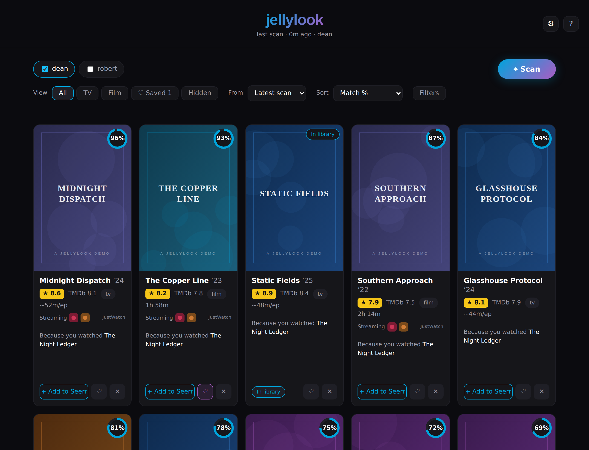
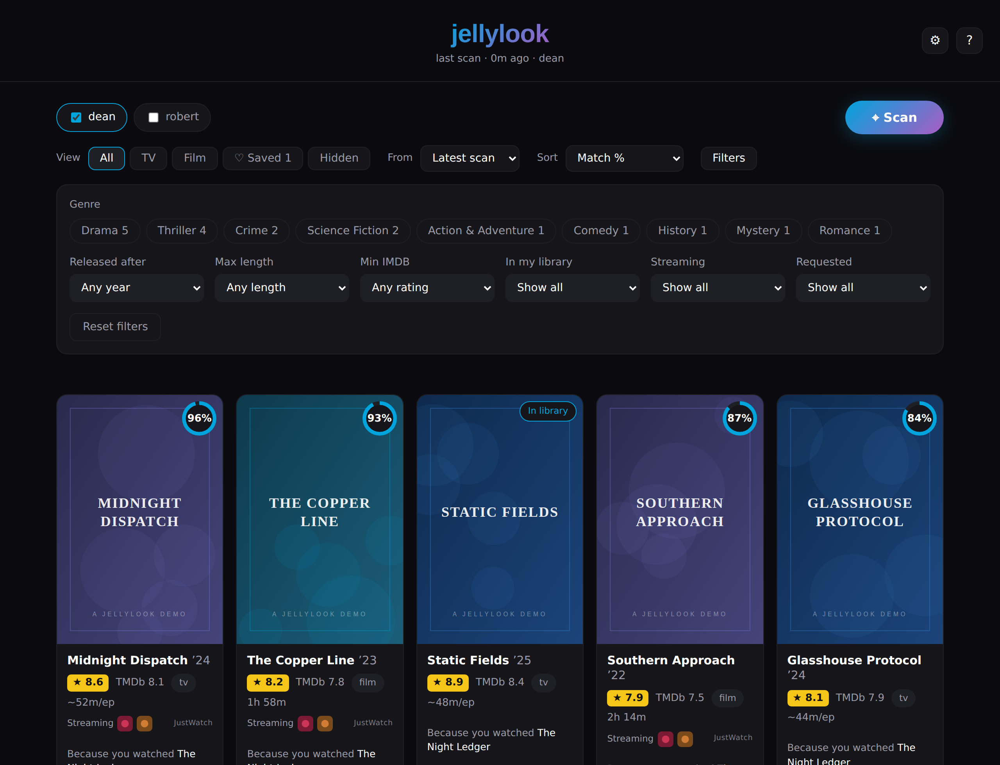
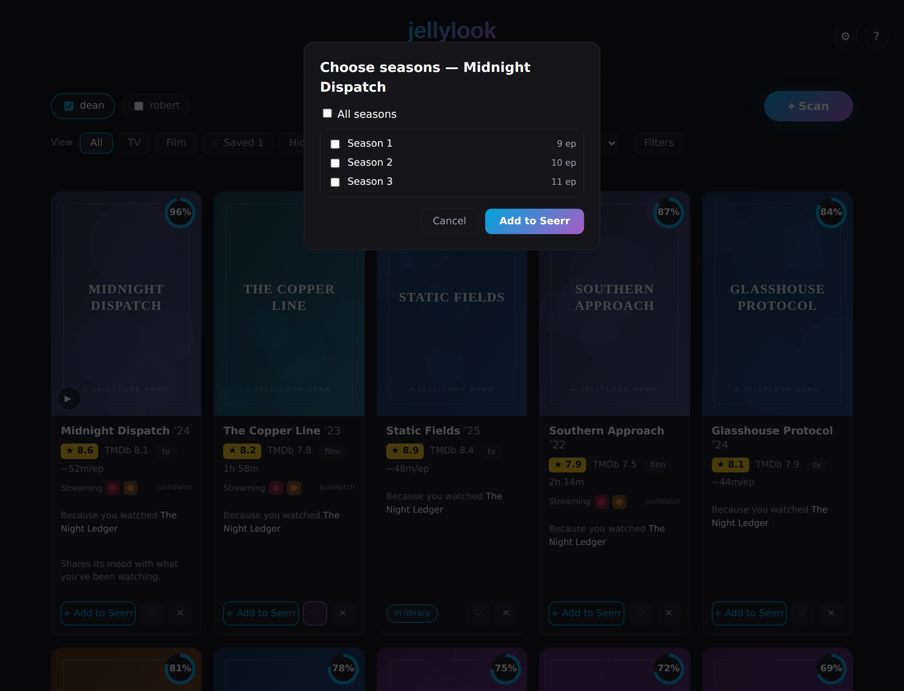
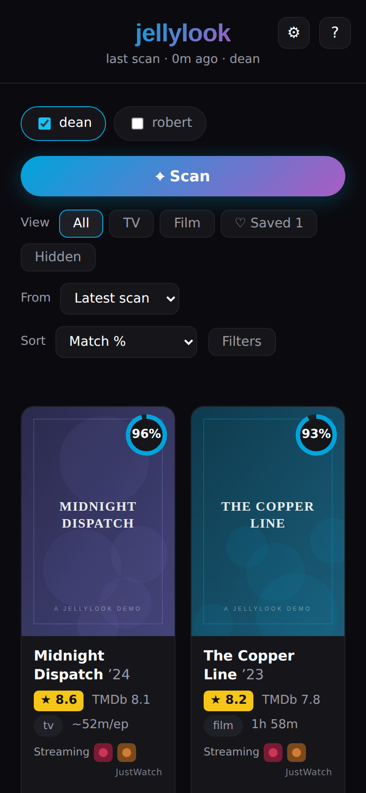

<div align="center">


**Self-hosted "what to watch next" for Jellyfin — and Plex.**

One AI call. Sixty recommendations. Zero subscriptions.

[](LICENSE)
[](https://www.python.org/)
[](https://github.com/dean1850/jellylook/pkgs/container/jellylook)
[](https://github.com/dean1850/jellylook/actions/workflows/docker-publish.yml)



</div>

---

jellylook reads your **recent watch history** from [Jellystat](https://github.com/CyferShepard/Jellystat) (Jellyfin) or [Tautulli](https://github.com/Tautulli/Tautulli) (Plex), asks an AI provider — **one call per scan** — for a batch of similar titles, enriches them with **IMDB (OMDb) + TMDb** ratings and artwork, and shows them as poster cards with a match %, a "Because you watched…" line, and a one-click **Add to Seerr** (Overseerr/Jellyseerr) button.

Tell it what you liked and what you didn't, and the next scan listens. Dark-only, Jellyfin palette. Results are kept for 60 days, then purged automatically.

> The screenshots on this page use fictional demo titles and generated artwork — your instance shows real posters from TMDb.

## Features

- **No build step** — a prebuilt multi-arch image is published to `ghcr.io/dean1850/jellylook`. Runs on x86 and on ARM (Raspberry Pi, Synology, QNAP).
- **Pick your AI** — Anthropic (Claude), OpenAI, Google AI (Gemini), Open WebUI, or Ollama. Switch with one line in `.env`; run fully local with Ollama if you like.
- **One AI call per scan** returns the whole batch (default 60). Sorting, filtering, paging and Seerr requests never trigger another call.
- **It learns** — ♡ save a title or ✕ hide it. Hidden titles never come back, and both lists are shown to the AI on the next scan as liked and rejected examples. [More below](#teaching-it-what-you-like).
- **Feedback is per viewer** — two people on one server keep separate taste, with no extra setup: a verdict belongs to whoever is ticked in *who's watching*.
- **Where to watch** — streaming availability per card for your region, plus a trailer link. Both come from TMDb, so there's no extra API key.
- **Real filters** — genre (with live counts), decade, runtime, minimum IMDB, hide what you already own, hide what you've already requested, or show only what you can't already stream.
- **Latest scan or all time** — browse one batch, or every title suggested inside the retention window, deduplicated and newest-first.
- **Match %** and **"Because you watched \<seed\>"** on every card, so you can see why each title was suggested.
- **Add to Seerr** — movies request in one click, TV opens a season picker. Titles you already own show an "In library" chip instead.
- **Jellystat (or Tautulli) is the taste signal**; Jellyfin is used only for the ownership check and as a fallback history source. On a Plex setup, Tautulli covers users, history and the ownership check by itself — no Jellyfin needed.
- SQLite storage, metadata cache (keeps you under OMDb's 1,000/day free limit — today's usage shows in Settings), automatic purge with a one-year hard ceiling.
- Single container: FastAPI + vanilla HTML/CSS/JS. No database server, no telemetry, no third-party embeds.

## Screenshots

| Filters and genre facets | Season picker | Mobile |
|:---:|:---:|:---:|
|  |  |  |

## Teaching it what you like

Every card carries two buttons.

| | What it does |
|---|---|
| **♡ Save** | Keeps the title in a **Saved** list. Shown to the AI next scan as something you liked. |
| **✕ Not for me** | Removes the card and never suggests that title again. Shown to the AI next scan as something you rejected. Reversible from the **Hidden** list. |

Three things worth knowing:

- **A verdict belongs to the people ticked in *who's watching*.** One person ticked records one person's opinion; a household watching together ticks both and speaks for both. There is no separate "who is voting" setting to keep in sync.
- **A scan for several people skips anything *any* of them has hidden.** Showing something one viewer has banned is worse than omitting something another merely bookmarked.
- **It takes about three of each before the AI leans on them.** Two rejected horror films aren't evidence that you dislike horror, so jellylook stays quiet until there's a real signal — and it caps how much of the prompt your history can occupy.

Hiding is enforced twice: once as a request to the model, and again after TMDb resolves each suggestion to an id. The second pass is the one that counts — models return excluded titles anyway, and matching on the title string alone would confuse *The Office* (US) with *The Office* (UK).

## Requirements

- **Docker** with Docker Compose (any recent version — the compose file uses the modern format).
- One of:
  - a running **Jellyfin** server and a **Jellystat** instance pointed at it, **or**
  - a running **Plex** server and a **Tautulli** instance pointed at it.
- **Overseerr or Jellyseerr** if you want the Add-to-Seerr button (optional — cards still render without it).
- Free API keys for **TMDb** and **OMDb**, plus a key for whichever AI provider you choose (or a local Ollama, which needs none).

## Quick start

No clone, no build — you need two files.

### 1. Create a folder and fetch the files

```bash
mkdir jellylook && cd jellylook
curl -O https://raw.githubusercontent.com/dean1850/jellylook/main/docker-compose.yml
curl -o .env https://raw.githubusercontent.com/dean1850/jellylook/main/.env.example
```

### 2. Fill in `.env`

Open `.env` in an editor. The minimum you must set depends on your media server:

| Your setup | `HISTORY_SOURCE` | Keys you must fill in |
|---|---|---|
| Jellyfin + Jellystat | `jellystat` (default) | `JELLYSTAT_API_KEY`, `JELLYFIN_API_KEY` |
| Plex + Tautulli | `tautulli` | `TAUTULLI_API_KEY` |
| Jellyfin only | `jellyfin` | `JELLYFIN_API_KEY` |

Everyone also needs `TMDB_API_KEY`, `OMDB_API_KEY` and one AI provider key. `SEERR_API_KEY` is optional. Full list of every setting is in [Configuration](#configuration) below.

Outside Australia, set `TMDB_REGION` to your country (`US`, `GB`, `DE`, `CA`…) so
"where to watch" shows services you can actually get. Everything else has a
sensible default — you do not need to touch it.

Then point the URLs at your servers — `JELLYSTAT_URL`, `JELLYFIN_URL` (or `TAUTULLI_URL`) and `SEERR_URL`. **Use LAN IPs, not `localhost`** — these URLs are dialled from *inside* the container, where `localhost` is the container itself.

Settings you don't use can stay at their placeholder values; jellylook only reads the ones your `HISTORY_SOURCE` and `LLM_PROVIDER` select.

### 3. Start it

```bash
docker compose up -d
```

jellylook fails fast on missing configuration and prints exactly which `.env` variables it still needs — if the container exits immediately, run `docker compose logs jellylook` and it will tell you what to fix.

### 4. Open it

Go to `http://<your-host>:3045`, tick who's watching, and press **Scan**. The first scan takes a minute or so (one AI call plus metadata lookups for ~60 titles); everything after that — sorting, filtering, paging, saving, hiding, Seerr requests — is instant and free.

Then start marking cards ♡ and ✕. The next scan will already be better.

## Updating

```bash
docker compose pull
docker compose up -d
```

Your SQLite database lives in `./data` next to the compose file and survives updates. Schema changes are applied automatically at startup, so upgrading from an earlier version needs no migration step — existing recommendations keep working, and gain genre/runtime/streaming data as they are re-scanned.

To pin a specific release instead of tracking `latest`, change the tag in `docker-compose.yml`:

```yaml
image: ghcr.io/dean1850/jellylook:1.0.0
```

Available tags: `latest` (newest build of `main`), `sha-abc1234` (an exact commit), and — once a release is tagged — `1.0.0` / `1.0`.

## Configuration

Secrets and startup options live in `.env`. Day-to-day preferences (default users, batch size, TV request mode, default sort/filter) are edited in the app's **Settings** panel and stored in SQLite — those take effect immediately, no restart.

After editing `.env`, apply it with `docker compose up -d --force-recreate`.

### Core

| Variable | Default | What it does |
|---|---|---|
| `TZ` | `Australia/Sydney` | Timezone used for log timestamps |
| `JELLYLOOK_PORT` | `3045` | Host port the UI is served on |
| `RETENTION_DAYS` | `60` | How long results and cached metadata are kept before purge. Titles you saved are exempt |
| `MAX_RETENTION_DAYS` | `365` | Hard ceiling — nothing survives past this, saved titles included. Keeps a long-running instance from growing without bound |
| `RECS_PER_SCAN` | `60` | Titles requested per scan (5–100). The **Settings** panel overrides it; saving the panel back to this value hands control to `.env` again |
| `PER_PAGE` | `20` | Cards per page |
| `EXCLUDE_BUDGET` | `300` | Titles the prompt may spend telling the AI what *not* to suggest. Lower it for local models with a small context window |
| `LOG_LEVEL` | `INFO` | Container log verbosity — `DEBUG`, `INFO`, `WARNING`, `ERROR` |

Every one of these has a working default — a `.env` that only carries your API
keys is a complete configuration.

### Housekeeping

Two retention windows, because saving a title should mean something without
letting the database grow forever:

1. **`RETENTION_DAYS`** (60) clears ordinary results and cached metadata. Titles
   you have **saved** are skipped.
2. **`MAX_RETENTION_DAYS`** (365) is absolute and skips nothing. A saved title
   ages out after a year like everything else.

Your **save and hide decisions are never deleted** — they are a few bytes each,
and expiring them would silently resurrect titles you had already rejected. A
title you hid two years ago stays hidden even though its card is long gone.

Purge runs at startup and once a day after that.

### Watch-history source

`HISTORY_SOURCE` picks your media-server stack. Only the block for the source you choose is used; the rest is ignored.

| Variable | Default | What it does |
|---|---|---|
| `HISTORY_SOURCE` | `jellystat` | `jellystat` (Jellyfin + Jellystat), `tautulli` (Plex + Tautulli), or `jellyfin` (Jellyfin alone, no Jellystat) |
| `JELLYSTAT_URL` | `http://192.168.1.5:3015` | Your Jellystat address |
| `JELLYSTAT_API_KEY` | — | Jellystat → Settings → API Keys |
| `JELLYFIN_URL` | `http://192.168.1.5:8096` | Your Jellyfin address |
| `JELLYFIN_API_KEY` | — | Jellyfin → Dashboard → API Keys. Used for the library ownership check and as an id/poster fallback |
| `TAUTULLI_URL` | `http://192.168.1.5:8181` | Your Tautulli address |
| `TAUTULLI_API_KEY` | — | Tautulli → Settings → Web Interface → API key |

On Plex (`tautulli`), Tautulli supplies users, history *and* the ownership check — no Jellyfin keys are needed and the Jellyfin lines are ignored.

### Requests (Overseerr / Jellyseerr)

| Variable | Default | What it does |
|---|---|---|
| `SEERR_URL` | `http://192.168.1.5:5055` | Your Overseerr or Jellyseerr address |
| `SEERR_API_KEY` | — | Overseerr/Jellyseerr → Settings → General. Optional; without it the Add-to-Seerr button stays disabled |

### AI provider

Set `LLM_PROVIDER` and `LLM_MODEL`, then fill in **only** the keys for that provider — the others can stay blank.

| `LLM_PROVIDER` | Needs | Example `LLM_MODEL` |
|---|---|---|
| `anthropic` | `ANTHROPIC_API_KEY` | `claude-haiku-4-5` |
| `openai` | `OPENAI_API_KEY` (+ optional `OPENAI_BASE_URL`) | `gpt-4o-mini` |
| `google` | `GOOGLE_API_KEY` — from [aistudio.google.com/apikey](https://aistudio.google.com/apikey) | `gemini-2.0-flash` |
| `openwebui` | `OPENWEBUI_API_KEY` + `OPENWEBUI_BASE_URL` | whatever your instance serves |
| `ollama` | `OLLAMA_BASE_URL` only — no key | `qwen3:14b` |

| Variable | Default | What it does |
|---|---|---|
| `LLM_PROVIDER` | `anthropic` | `anthropic`, `openai`, `google`, `openwebui` or `ollama` |
| `LLM_MODEL` | `claude-haiku-4-5` | Model name, as your provider spells it |
| `LLM_TEMPERATURE` | `0.7` | Creativity of the suggestions — lower is safer, higher is more adventurous |
| `OPENAI_BASE_URL` | `https://api.openai.com/v1` | Point at any OpenAI-compatible endpoint (LM Studio, LiteLLM, vLLM…) |
| `OPENWEBUI_BASE_URL` | `http://192.168.1.6:8080` | Your Open WebUI address; the key comes from your Open WebUI account settings |
| `OLLAMA_BASE_URL` | `http://192.168.1.6:11434` | Your Ollama address |

Open WebUI is called through its OpenAI-compatible endpoint (`{OPENWEBUI_BASE_URL}/api/chat/completions`).

### Ratings and artwork

| Variable | Default | What it does |
|---|---|---|
| `TMDB_API_KEY` | — | Free v3 key from [themoviedb.org](https://www.themoviedb.org/settings/api). Supplies ids, posters, backdrops, scores, genres, runtimes, trailers and streaming availability |
| `OMDB_API_KEY` | — | Free key from [omdbapi.com](https://www.omdbapi.com/apikey.aspx) — 1,000 lookups/day. Supplies IMDB ratings |
| `TMDB_REGION` | `AU` | ISO 3166-1 country code for "where to watch" — `US`, `GB`, `DE`, `CA`… |

Streaming availability and trailers ride along on the TMDb request jellylook was
already making (`append_to_response`), so they add **no** extra API calls and no
extra key. Availability is stored per title when it is scanned, so changing
`TMDB_REGION` applies to new scans; existing cards keep the region they were
scanned under.

## Verifying the install

With a filled `.env`:

```bash
docker compose run --rm jellylook python -m app.selftest
```

This enriches a known title through TMDb + OMDb, proves the cache works, and asks your active AI provider for 5 sample recommendations.

## Running the tests

The test suite needs no API keys and makes no outbound requests — the browser
tests drive the real app against a mock stand-in for Jellystat, Jellyfin, TMDb,
OMDb, Seerr and the LLM.

```bash
pip install -r requirements.txt -r requirements-dev.txt
python -m pytest tests/test_db.py tests/test_llm.py tests/test_recommender.py -q   # ~4s

python -m playwright install chromium
tests/e2e/harness.sh start
python -m pytest tests/e2e/test_ui.py -q
tests/e2e/harness.sh stop
```

Both suites run in CI on every push.

## Building from source

Contributors and anyone who'd rather not pull a prebuilt image can build locally:

```bash
git clone https://github.com/dean1850/jellylook.git
cd jellylook
cp .env.example .env      # then fill it in
docker compose -f docker-compose.build.yml up -d --build
```

`docker-compose.build.yml` is identical to the published one except it builds from the Dockerfile instead of pulling from ghcr.io.

Every push to `main` runs [the workflow](.github/workflows/docker-publish.yml), which boots the freshly built image and checks its health endpoint, UI and API before publishing `linux/amd64` and `linux/arm64` images. Tagging a release (`git tag v1.2.3 && git push --tags`) publishes `1.2.3` and `1.2` alongside `latest`.

> Forking this repo? The published package inherits your fork's visibility, so a public fork publishes a publicly pullable image with no extra steps. If a fork's package does come out private, open Packages → jellylook → Package settings → Change visibility → Public, or `docker compose pull` fails with `denied` for everyone but you.

## How a scan works

1. Recent plays for the selected user(s) are pulled from Jellystat (Jellyfin fallback) — or from Tautulli on a Plex setup — and weighted by recency and play count.
2. An exclusion list is assembled by priority within `EXCLUDE_BUDGET`: titles those viewers **hid** first, then what they've watched, then what earlier scans already offered. An explicit rejection is worth more prompt space than the 150th watched title.
3. One request to your AI provider returns the whole batch as JSON — title, year, type, a one-line reason, a 0–100 match estimate, and the watched title it's based on. Saved and hidden titles ride along as liked/rejected examples once there are at least three of either.
4. Each suggestion is resolved via TMDb (id, poster, backdrop, score, genres, runtime, trailer, streaming availability) and OMDb (IMDB rating), with every lookup cached.
5. Anything the model returned that those viewers had hidden is dropped here — after resolution, matched on TMDb id rather than on the title text.
6. Titles already in your library are flagged (Jellyfin matches on IMDb/TMDb ids; Plex matches on title + year via Tautulli); anything you've already watched is dropped.
7. Results land in SQLite and render 20 per page.

The match % is the model's own similarity estimate — directionally useful, not science.

## Troubleshooting

- **`docker compose pull` says `denied` / `unauthorized`** — the image you're pulling is a private package. `ghcr.io/dean1850/jellylook` is public and needs no login; on a fork, check your own package's visibility (see [Building from source](#building-from-source)).
- **Container exits at startup** — jellylook fails fast on missing config and prints exactly which `.env` variables it needs. Check `docker compose logs jellylook`.
- **No users / scan fails immediately** — the history source (Jellystat, Tautulli or Jellyfin) is unreachable or the API key is wrong. The URLs must be reachable *from inside the container* (use LAN IPs, not `localhost`).
- **Add to Seerr disabled** — Seerr didn't answer; cards still work and the button returns when Seerr does.
- **OMDb limit** — the free key allows 1,000 lookups/day. The cache makes re-scans nearly free; Settings shows today's count.
- **"returned no usable recommendations"** — the model answered but gave nothing back. Usually a small local model ignoring the JSON format, or an exclude list so long there was nothing left to suggest. Try a larger model, or lower `EXCLUDE_BUDGET`.
- **A genre filter hides older titles** — recommendations scanned before this version have no genre data, and jellylook won't claim an unknown genre is a match. The status line says how many were held back; they age out on their own.
- **No streaming logos** — check `TMDB_REGION` matches a country TMDb has data for, and remember availability is recorded at scan time, so existing cards keep the region they were scanned under.
- **`exec format error`** — you're on hardware the image wasn't built for. The published image covers `linux/amd64` and `linux/arm64`; 32-bit ARM (older Raspberry Pi OS) needs a local build.

## Security

jellylook has **no built-in authentication** — it is designed to run on a trusted home LAN. Anyone who can reach the port can trigger scans (which spend your AI provider credits), change app settings, and file Overseerr/Jellyseerr requests.

- **Do not expose the port directly to the internet.** If you want remote access, put it behind a VPN (WireGuard, Tailscale) or a reverse proxy with authentication (e.g. Nginx Proxy Manager, Authelia, Caddy with basic auth).
- To restrict it to the Docker host only, bind the port to localhost in `docker-compose.yml`: `"127.0.0.1:3045:8000"`.
- Keep your real `.env` out of version control — it holds all your API keys. The repo's `.gitignore` already excludes it; never force-add it.

## Privacy

jellylook sends your recent watch **titles** (not full history, not identities) to whichever AI provider you configure, and title lookups to TMDb and OMDb. Titles you save or hide are sent too, as examples of what to lean toward and away from. If you'd rather nothing leaves your network, point `LLM_PROVIDER=ollama` at a local model — then only the TMDb/OMDb metadata lookups go out.

Trailers are **links**, not embedded players: nothing loads from Google unless
you click through. Posters and provider logos are served from TMDb's image CDN.

## Stack

Python 3.12 · FastAPI · httpx · SQLite (WAL) · vanilla HTML/CSS/JS · one Docker container.

## License

[MIT](LICENSE) — do what you like, no warranty. Not affiliated with Jellyfin, Jellystat, Plex, Tautulli, Overseerr/Jellyseerr, TMDb, OMDb, JustWatch, or any AI provider.

This product uses the TMDB API but is not endorsed or certified by TMDB.
Streaming availability data provided by **JustWatch**.
